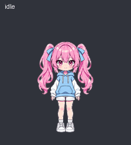
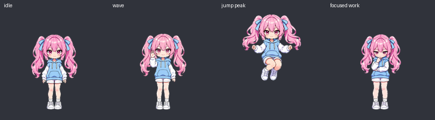

# Нана — аниме-питомец

Розовые хвостики, голубое худи и спокойный характер. Девять анимаций и шестнадцать направлений взгляда.

**[Открыть интерактивное демо](https://darlinginsteam.github.io/nana-anime-pet/)** · **[Скачать спрайт-лист](assets/nana.png)**

## Как выглядит

Анимации видны прямо здесь:





В демо можно выбрать анимацию, поставить её на паузу, увеличить персонажа и включить слежение взглядом за курсором. Размер в демо не меняет размер питомца в приложении.

## Запуск локально

Без сборки и зависимостей. Из папки репозитория:

```sh
python -m http.server 8000
```

Открыть [localhost:8000](http://localhost:8000).

## Файлы

| Файл | Содержание |
| --- | --- |
| `assets/nana.png` | Прозрачный PNG 1536 × 2288, сетка 8 × 11, ячейка 192 × 208 |
| `pet.json` | Количество кадров, длительности и порядок направлений взгляда |
| `previews/animations.gif` | Девять анимаций в одном цикле |
| `previews/animations.mp4` | Видеоверсия примера |
| `previews/look-directions.gif` | Полный цикл направлений взгляда |
| `index.html`, `app.js`, `style.css` | Интерактивный просмотрщик |

Первые девять строк содержат 6, 8, 8, 4, 5, 8, 6, 6 и 6 кадров. Две последние — по восемь взглядов, по часовой стрелке от направления вверх. Неиспользуемые ячейки прозрачны. Всего 73 кадра.

## Происхождение

Изображения созданы с помощью ИИ (OpenAI imagegen). Визуальный ориентир — [Nana (refined) из LivLiv Player](https://livliv-dev.github.io/player/example/demo.html): розовые волосы и голубое худи. [Исходный проект LivLiv](https://github.com/livliv-dev/player).

В репозитории опубликованы сгенерированные спрайты и простой просмотрщик. Модель `.livliv`, движок LivLiv и его исходные текстуры сюда не включены.
